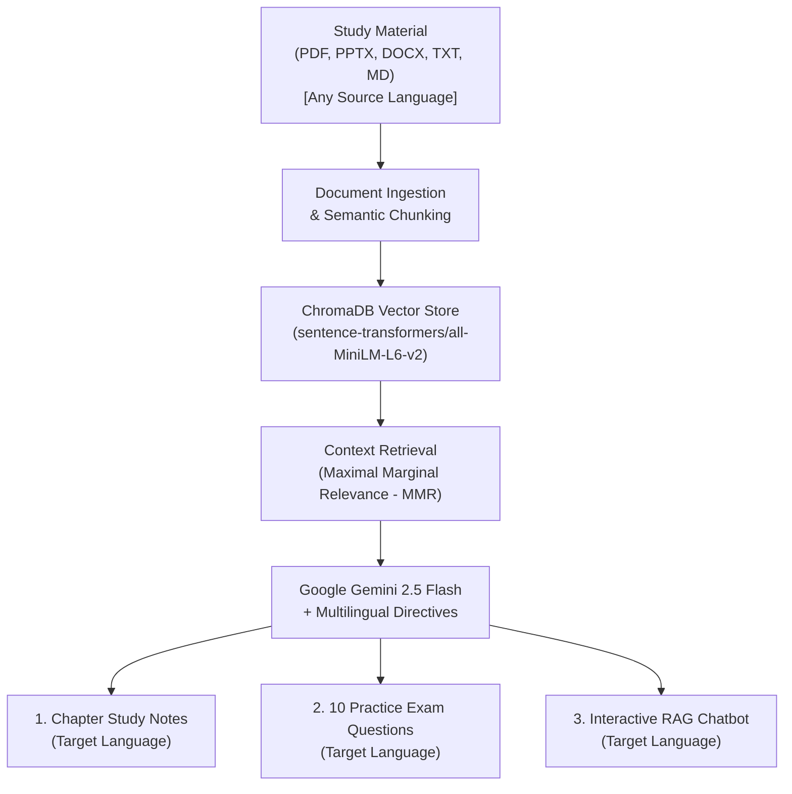

# BhashaLearn — Multilingual Study & Revision Assistant

<p align="center">
  
  
  
  
  
  
</p>

---

## 📌 Overview

**BhashaLearn** is an AI-powered, multilingual study and revision assistant engineered to break language barriers in education. Whether you are revising a complex research paper, lecture slides, or textbook chapters, BhashaLearn allows you to upload study material in **any document format and language**, and seamlessly transforms it into structured study notes, practice exam questions, and an interactive RAG chatbot — **all in your chosen target language**.

> 💡 **Input and output languages are completely independent.**  
> *Upload a German research paper → Study in Hindi.*  
> *Upload an English lecture slide deck → Revise in classical Sanskrit.*  
> *Upload a Russian technical manual → Practice in English.*

---

## 🌐 The Multilingual Focus

Students and researchers frequently face a dual hurdle: grasping complex technical content while deciphering materials published in non-native languages. BhashaLearn bridges this gap through a high-fidelity cross-lingual retrieval-augmented generation (RAG) architecture.



### 1. Pure Cross-Lingual Synthesis
- **Decoupled Processing**: Ingest materials in English, German, French, Russian, Hindi, etc., without needing pre-translation.
- **Academic Fidelity**: The LLM preserves domain-specific nuances, mathematical formulations, and technical definitions while fluently explaining concepts in the target language.

### 2. Supported Language Matrix

| Code | Language | Native Name | Script | Linguistic Highlights & Fallback Message |
| :---: | :--- | :--- | :--- | :--- |
| `en` | **English** | English | Latin | Precise academic phrasing, bulleted summaries, and clear explanations.<br>_Fallback: "I could not find the answer in the document."_ |
| `hi` | **Hindi** | हिन्दी | Devanagari | Natural standard Hindi for conceptual clarity.<br>_Fallback: "मुझे दस्तावेज़ में इसका उत्तर नहीं मिला।"_ |
| `sa` | **Sanskrit** | संस्कृतम् | Devanagari | **Classical Sanskrit (`विद्वद्भाषया`)**: Strict grammatical paradigms (vibhakti, sandhi, subanta/tinganta), avoiding transliteration or Hindi idioms.<br>_Fallback: "अस्मिन् दस्तावेजे उत्तरं न प्राप्तम्।"_ |
| `de` | **German** | Deutsch | Latin | Fluent Hochdeutsch with accurate compound noun synthesis and grammar.<br>_Fallback: "Ich konnte die Antwort im Dokument nicht finden."_ |
| `ru` | **Russian** | Русский | Cyrillic | Idiomatic academic Russian with rigorous technical declension.<br>_Fallback: "Я не смог найти ответ в документе."_ |

### 3. Dedicated Classical Sanskrit Engine
Unlike standard translation tools that produce Romanized phonetic output or Hindi sentences with Sanskrit suffixes, BhashaLearn enforces authentic classical Sanskrit composition:
- Employs appropriate case inflections (*vibhakti*) and verbal conjugations (*dhaturoopa*).
- Retains authentic scholarly Sanskrit prose (*saralam kintu shuddham samskritam*).

### 4. Cross-Lingual RAG Chatbot
- Ask follow-up questions in **any phrasing or language** (e.g., asking in conversational English or Hinglish about an uploaded Sanskrit or German treatise).
- The chatbot retrieves strictly grounded evidence from the document vector database and replies **in your selected target study language**.
- If the queried concept is absent from the uploaded material, the chatbot responds with the exact localized fallback phrase instead of hallucinating.

---

## ✨ Core Features

- 📑 **Universal Format Ingestion**: Accepts `.pdf`, `.pptx`, `.ppt`, `.docx`, `.txt`, and `.md` files.
  - Extracts text, table cells, slide headings, bullet points, and speaker notes.
- 📝 **Structured Chapter Study Notes**: Generates high-yield revision summaries, core concepts, formulas, and bulleted takeaways.
- 🎯 **Exam-Ready Practice Questions**: 10 conceptual, high-yield questions accompanied by an expandible answer key and detailed explanations.
- 🔍 **Strict Grounding with MMR**: Embeddings generated via `sentence-transformers/all-MiniLM-L6-v2` with Maximal Marginal Relevance (MMR) retrieval to prevent repetition and maximize topical coverage.
- 🔒 **In-Memory Session Isolation**: Vector stores exist in-memory per session; no user study materials persist across restarts.
- 🎨 **Responsive Glassmorphism Interface**: Clean, accessible UI with live markdown rendering for mathematical notes, code blocks, and tables.

---

## 🛠️ Tech Stack

- **Backend & Web**: Flask, Flask-WTF, WTForms, Gunicorn, Python-dotenv
- **LLM & Orchestration**: LangChain, `langchain-google-genai`, Google Gemini 2.5 Flash
- **Document Extractors**: `pypdf`, `python-docx`, `python-pptx`
- **Embeddings & Vector Store**: `sentence-transformers/all-MiniLM-L6-v2`, `langchain-huggingface`, ChromaDB (in-memory)
- **Frontend**: Modern HTML5, CSS3 Glassmorphism, Vanilla JavaScript, Markdown rendering via Python-Markdown

---

## 📁 Repository Structure

```text
BhashaLearn/
├── templates/
│   ├── index.html            # Landing & multi-format upload with language selection
│   ├── result.html           # Structured notes, practice questions & RAG chat UI
│   └── error.html            # Localized error display
├── uploads/                  # Temporary file processing directory (gitignored)
├── .env.example              # Environment variables template
├── copilot-instructions.md   # Architectural & coding standards
├── main.py                   # Flask server, document parsers & LangChain RAG pipeline
├── README.md                 # Project documentation
└── requirements.txt          # Production dependencies
```

---

## 🚀 Getting Started

### 1. Prerequisites
- Python 3.10 or higher
- A Google Gemini API Key ([Get one for free at Google AI Studio](https://aistudio.google.com/))

### 2. Clone the Repository
```bash
git clone https://github.com/yourusername/BhashaLearn.git
cd BhashaLearn
```

### 3. Create and Activate Virtual Environment
```bash
# Windows
python -m venv venv
venv\Scripts\activate

# macOS / Linux
python3 -m venv venv
source venv/bin/activate
```

### 4. Install Dependencies
```bash
pip install -r requirements.txt
```

### 5. Configure Environment Variables
Create a `.env` file in the project root:
```bash
cp .env.example .env
```

Edit `.env` to include your configuration:
```env
SECRET_KEY=your_secure_flask_secret_key
GEMINI_API_KEY=your_gemini_api_key_here
# Optional: GEMINI_MODEL=gemini-2.5-flash
# Optional: FLASK_DEBUG=0
```

### 6. Run the Application
```bash
python main.py
```
Open **[http://127.0.0.1:5000](http://127.0.0.1:5000)** in your browser.

---

## 🧪 How to Use

1. **Select Target Language**: Pick from English, Hindi, Sanskrit, German, or Russian.
2. **Upload Study Material**: Drop in a PDF, PowerPoint presentation (`.pptx`), Word document (`.docx`), or plain Markdown/text file.
3. **Review Study Notes**: Review the structured summary of the material rendered in your target language.
4. **Practice with Exam Questions**: Test your comprehension against 10 custom questions and check the answers/explanations.
5. **Ask Follow-up Questions**: Use the RAG chat bar to dive deeper into any topic; responses remain strictly grounded in the document and localized in your target language.

---

## 🌐 Adding New Languages

Adding support for an additional language takes only seconds. Open [`main.py`](main.py) and append a new definition to `SUPPORTED_LANGUAGES`:

```python
"es": {
    "name": "Spanish",
    "native": "Español",
    "not_found": "No pude encontrar la respuesta en el documento.",
    "instruction": (
        "Respond ONLY in fluent, grammatically correct Spanish (Español). "
        "Use accurate academic and domain terminology."
    ),
}
```

---

## ☁️ Deployment

### Render / Railway / Cloud VM
1. Set the build command:
   ```bash
   pip install -r requirements.txt
   ```
2. Set the start command:
   ```bash
   gunicorn main:app
   ```
3. Add environment variables:
   - `SECRET_KEY`: Random 32+ character string
   - `GEMINI_API_KEY`: Your Google AI Studio API key
   - `FLASK_DEBUG`: `0`

---

## 📄 License & Attribution

Designed and developed by **Kunal Singh**.  
Open-source under the [MIT License](LICENSE).